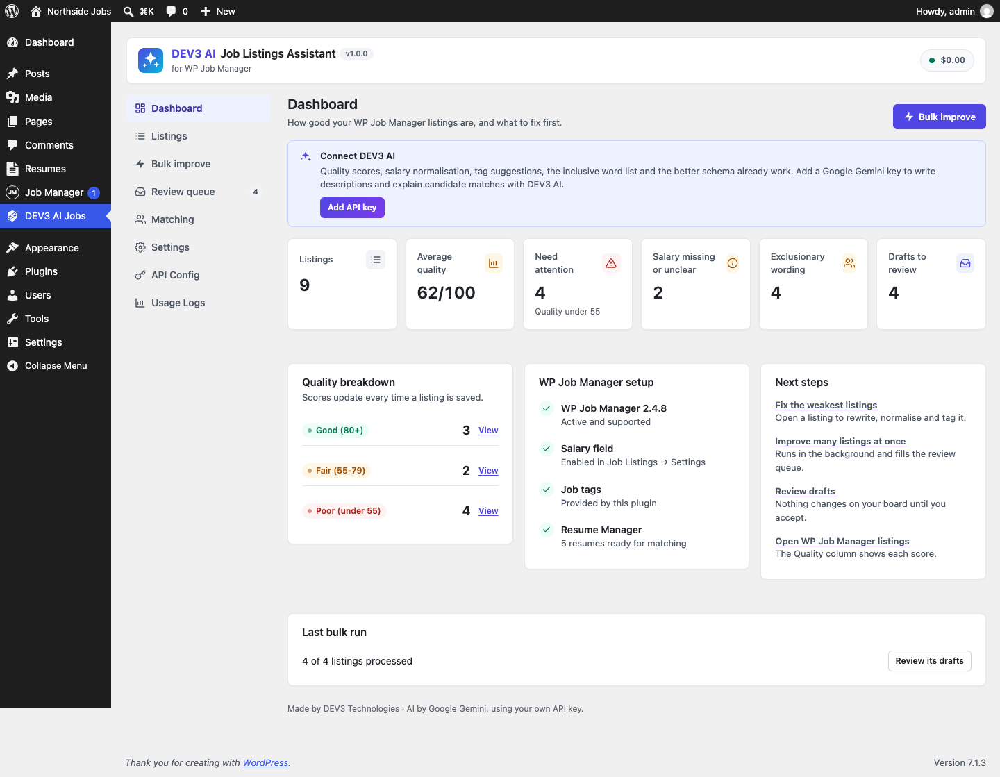

# DEV3 AI Job Listings Assistant for WP Job Manager

An add-on for the free WP Job Manager plugin: AI job descriptions, inclusive-language checks, salary and title normalisation, job type and tag suggestions, better Google for Jobs schema, candidate matching and bulk improvements with review.



## Features

DEV3 AI Job Listings Assistant makes every WP Job Manager listing clearer, fairer and easier to find. It works inside WP Job Manager: the front-end submit form, the job edit screen and the Job Listings table, plus its own DEV3 AI screen.

**Listing quality**

* A 0-100 quality score for every listing (description length and structure, salary, job type, location, company, title, tags, inclusive wording), updated on every save.
* A sortable Quality column and an "Improve with DEV3 AI" row action in Job Listings.
* A dashboard with the weakest listings and what to fix first.

**Write and check**

* Job description writer with tone presets, from notes or the current description. Drafts are shown side by side with the current text and saved only when you accept.
* Inclusive-language check: a built-in word list (age-coded, gender-coded, ableist, origin and jargon terms) plus context-aware DEV3 AI findings, with one-click replacements.
* Both are available to employers on the front-end [submit_job_form] (neutral wording, no plugin branding) and to editors in the job edit screen.

**Structured data**

* Salary normalisation: "$50k-70k/yr", "£30,000 - £35,000 per annum", "20-25 USD/hour", "INR 12 LPA" become numbers, ISO currency and pay period in WP Job Manager's own salary fields.
* Title clean-up: removes hype words, emojis, shouting and pay from titles, expands abbreviations (Sr → Senior) and detects seniority.
* Job type, category and tag suggestions constrained to the terms you already use. Adds a Job tags taxonomy when the Job Tags add-on is not installed.
* Better JobPosting schema through WP Job Manager's own filter: numeric baseSalary ranges, remote jobs without a location (TELECOMMUTE + applicant country), employment types, experience, skills and industry. A schema checklist per listing.

**Candidate matching (with the WP Job Manager Resume Manager add-on)**

* Ranks resumes against a job with four transparent criteria (skills, experience, role fit, location), strengths and gaps, and an optional DEV3 AI explanation.
* Decision support only: nothing changes a resume or application, and every candidate stays visible.

**Bulk improve**

* Improve many listings in one background run (low quality, missing salary, missing type/tags, exclusionary wording, all, or selected).
* Every change lands in a review queue: accept, edit or reject; "Accept safe changes" applies salary, title and taxonomy updates in one click.

**DEV3 AI (optional, uses your own Google AI API key)**

Everything except AI writing and AI explanations works without a key: rules, templates and the word list are built in. A monthly budget cap, an AI kill switch and a separate switch for visitor-facing AI are in API Config.

**Fairness**

Matching never uses names, contact details, photos, age or date of birth, gender, marital or family status, nationality, ethnicity, religion, disability, health, sexual orientation, union membership, political views or street addresses. They are removed before scoring and never sent to AI.

**Privacy**

AI features send listing text (and anonymised resume data for matching) to Google AI only when you add an API key. The plugin adds text to your privacy policy and supports the WordPress personal data exporter and eraser for match scores.

## Requirements

- WordPress 6.0 or newer (tested up to 6.8)
- PHP 7.4 or newer
- WP Job Manager (required)
- Optional: your own Google AI API key (from Google AI Studio) to switch on the DEV3 AI features. The rest of the plugin works without one.

## Installation

### From the release zip

1. Download `dev3-ai-wp-job-manager.zip` from the [latest release](https://github.com/dev3tech/dev3-ai-wp-job-manager/releases/latest).
2. In WordPress, go to **Plugins → Add New → Upload Plugin**, choose the zip and click **Install Now**.
3. Click **Activate**.

### Build from source

```bash
git clone https://github.com/dev3tech/dev3-ai-wp-job-manager.git
cd dev3-ai-wp-job-manager
composer install --no-dev
npm ci
npm run build
```

Then copy the `dev3-ai-wp-job-manager` folder into `wp-content/plugins/` and activate it.

### Getting started

1. Install and activate WP Job Manager (free, from WordPress.org).
2. Upload this plugin's zip in Plugins > Add New > Upload, then activate it.
3. Recommended: in Job Listings > Settings turn on "Enable Job Salary", salary currency and salary unit.
4. Open DEV3 AI Jobs to see your listing scores.
5. Optional: add a Google AI API key in DEV3 AI Jobs > API Config.

## FAQ

### Does it need WP Job Manager add-ons?
No. Resume Manager (paid) is only needed for candidate matching. When the Job Tags add-on is active its taxonomy is used; otherwise this plugin provides one.

### Does it change my listings automatically?
No. AI and bulk results are drafts. Listings change only when you accept a draft. The optional "Normalise salary on submit" setting rewrites clear salaries with rules only.

### Will it print a second JobPosting block?
No. It improves the JSON-LD that WP Job Manager already prints.

### What does AI cost?
You pay Google for your own API usage. Set a monthly cap in API Config.

## Documentation

The full HTML guide (installation, settings, hooks and FAQ) is in [`docs/index.html`](docs/index.html). Open it in a browser after cloning or downloading the repository.

## Changelog

### 1.0.0
* First release.

## Licence

Released under the GNU General Public License v2.0 or later (GPL-2.0-or-later). See [LICENSE](LICENSE).

## More from DEV3

- [DEV3 AI Job Listings Assistant for WP Job Manager on the DEV3 Marketplace](https://www.dev3.tech/item/dev3-ai-wp-job-manager)
- [More WordPress plugins, themes and templates from DEV3](https://www.dev3.tech/marketplace)
